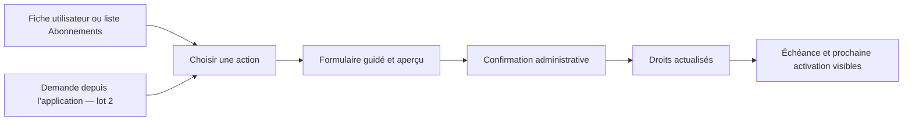

# Proposition — simplifier la gestion des abonnements

Proposition du 1er novembre 2026, fondée sur le [constat du fonctionnement actuel](2026-11-01-flux-abonnements-actuel.md). Les parcours décrits ici sont à implémenter ; ils ne constituent pas un état des fonctionnalités livrées.

## 1. Objectif et périmètre

Permettre à un administrateur de répondre rapidement à quatre questions :

1. Quelle formule donne réellement accès au service à cet utilisateur aujourd’hui ?
2. Jusqu’à quand cet accès est-il valable ?
3. Quelle action faut-il effectuer pour l’activer, le prolonger ou le modifier ?
4. Qui a effectué les changements, et pour quel motif ?

**La décision d’accorder un accès reste manuelle.** Le système calcule les dates, contrôle la cohérence et applique les droits correspondant à cette décision.

Cette proposition n’intègre aucun paiement : ni prestataire, ni encaissement, ni saisie de montant, ni vérification de transaction, ni prélèvement ou renouvellement automatique. Elle ne crée pas de statut « payé » ou « impayé ». Les écrans et historiques de facturation existants restent hors de cette refonte, sans suppression de leurs données. Les coupons restent également hors périmètre.

## 2. Principes proposés

- Un seul parcours métier, accessible depuis la fiche utilisateur et depuis la liste des abonnements.
- Un seul calcul de l’abonnement effectif, partagé par le backoffice, l’application et les contrôles serveur.
- Une formule accordée pour une durée explicite, avec date de fin calculée et récapitulatif avant confirmation.
- Des actions nommées : attribuer, démarrer un essai, renouveler, changer de formule, suspendre, reprendre, mettre fin.
- Aucun champ de statut libre à choisir pour simuler une action métier.
- Aucun identifiant utilisateur à recopier manuellement.
- Conservation des carnets et de l’historique ; aucune suppression de données lors d’une baisse de formule ou d’une expiration.
- Toute modification est autorisée côté serveur et journalisée avec un motif.

## 3. Un espace Abonnements conçu pour le suivi quotidien

Remplacer la liste générique actuelle par un écran dédié. Les vues et filtres restent partageables par URL et peuvent être enregistrés comme les autres vues du backoffice.

### Vues proposées

| Vue | Utilité |
|---|---|
| En cours | Accès actifs et essais actuellement valables. |
| Expirent bientôt | Échéances à 7 jours par défaut, avec choix 3, 7 ou 30 jours. |
| Essais | Essais en cours et dates de fin. |
| Expirés | Accès arrivés à terme, à examiner pour une nouvelle attribution. |
| Suspendus | Accès volontairement suspendus, avec motif et échéance conservée. |
| Prévus | Activations ou changements de formule à venir. |
| Historique | Périodes passées, remplacements, fins anticipées et annulations. |

Les compteurs doivent provenir du même calcul que la liste. Une échéance dépassée ne doit plus apparaître comme un accès actif.

### Colonnes et actions

Afficher le nom et l’e-mail de l’utilisateur, l’offre, la période, l’état effectif, les dates de début et de fin, le temps restant et la prochaine formule éventuelle. Les codes internes restent secondaires.

Proposer une recherche par nom ou e-mail et des filtres par offre, état et échéance. Un bouton **Attribuer un abonnement** ouvre une recherche d’utilisateur. Un clic sur une ligne ouvre le détail et ses actions disponibles.

Les changements sensibles restent individuels dans le premier lot. L’export CSV et les vues enregistrées suffisent pour préparer un suivi de plusieurs comptes ; une sélection groupée ne doit pas prolonger ou résilier des accès par erreur.

## 4. Une fiche d’abonnement lisible

La fiche utilisateur et le détail d’abonnement présentent le même encart de référence :

> **Accès actuel : Premium — actif**
>
> Du 1er novembre au 1er décembre 2026, à l’heure indiquée.
>
> Prochaine modification : aucune.
>
> Dernière action : attribution par un administrateur, avec son motif.

Présenter séparément :

- **L’accès effectif maintenant**, y compris Gratuit si aucun abonnement ne donne de droits.
- **L’abonnement suivi**, qui peut être expiré ou suspendu.
- **La prochaine période ou formule prévue**, si elle existe.
- **Les droits particuliers**, avec leurs motifs et dates de fin.
- **L’historique des actions**, consultable selon les permissions.

Exemple : afficher « Accès actuel : Gratuit — abonnement Premium expiré le… » plutôt que « Premium (actif) » lorsque sa date de fin est passée.

Sur grand écran, disposer les informations principales à gauche, les actions et échéances à droite, puis l’historique. Sur mobile, conserver cet ordre dans une seule colonne. Utiliser toute la largeur disponible.

## 5. Formulaires associés

### 5.1 Attribuer un abonnement

Un formulaire guidé en trois étapes, identique depuis tous les points d’entrée :

| Étape | Champs et comportement |
|---|---|
| Utilisateur | Recherche par nom ou e-mail ; utilisateur déjà renseigné et verrouillé depuis sa fiche. Résumé de l’accès actuel. |
| Offre et durée | Choix de l’offre par son nom, puis variante mensuelle ou annuelle disponible. Début maintenant ou à une date future. Fin calculée automatiquement. |
| Vérification | Résumé avant/après, dates exactes, droits et quotas modifiés, motif obligatoire, puis **Confirmer l’attribution**. |

Afficher les variantes indisponibles comme telles. Une formule archivée n’est pas proposée pour une nouvelle attribution. Une formule masquée au public peut rester attribuable par un administrateur autorisé.

Les durées standards sont un mois pour une variante mensuelle et douze mois pour une variante annuelle. Une durée personnalisée est un choix explicite, accompagné d’un motif ; elle ne doit pas être confondue avec la durée standard.

L’accès sans échéance est une option avancée réservée à une permission spécifique. Elle est désactivée par défaut et présentée comme une exception, avec confirmation explicite.

Si un accès existe déjà, proposer **Renouveler** ou **Changer de formule** au lieu de créer silencieusement un second abonnement concurrent.

### 5.2 Démarrer un essai

Choisir une offre disposant de jours d’essai configurés. Préremplir la durée depuis cette configuration et imposer une date de fin.

Afficher les essais déjà accordés à cet utilisateur. Règle proposée : un essai par utilisateur et par offre de base, indépendamment de la variante mensuelle ou annuelle. Une dérogation nécessite une permission et un motif distincts.

Un essai ne remplace pas implicitement un accès supérieur déjà valable. Une telle demande est traitée comme un changement de formule, avec aperçu des conséquences.

Dans le premier lot, l’essai est accordé par l’administration. Aucun essai ne démarre automatiquement à l’inscription. À son terme, l’accès revient à Gratuit si aucune autre période n’a été accordée.

### 5.3 Renouveler

Depuis une fiche ou une ligne, préremplir l’utilisateur, l’offre et la variante. Demander le nombre de périodes supplémentaires, avec une période par défaut, puis le motif.

- Accès encore valable : prolonger depuis sa date de fin, pour conserver les jours restants.
- Accès expiré : commencer une nouvelle période maintenant, ou à une date future choisie explicitement.
- Accès sans échéance : désactiver **Renouveler** et expliquer qu’il n’y a pas de fin à prolonger.
- Changement de formule déjà prévu : signaler le conflit et demander quelle période prolonger ; ne pas déplacer automatiquement la prochaine activation.

Le récapitulatif indique clairement **ancienne échéance → nouvelle échéance**. Le bouton final est **Confirmer le renouvellement**. Cette action est une décision d’accès, sans étape de paiement.

### 5.4 Changer de formule

Afficher l’offre actuelle, la nouvelle offre et deux choix : **Maintenant** ou **À l’échéance actuelle**.

| Choix | Effet proposé |
|---|---|
| Maintenant | Terminer l’ancienne période à l’instant du changement et démarrer la nouvelle pour la durée choisie. Afficher explicitement que la période précédente s’arrête ; aucune conversion implicite des jours restants. |
| À l’échéance | Conserver les droits actuels jusqu’à leur fin et programmer la nouvelle offre à cet instant. |

Pour un accès actuel sans échéance, le choix « À l’échéance » est indisponible ; une date explicite peut être proposée dans les options avancées.

L’aperçu montre les fonctionnalités gagnées ou perdues, les quotas avant/après et les éventuels dépassements, en tenant compte des droits particuliers encore valables. Les données déjà enregistrées restent conservées. Un dépassement empêche les nouveaux ajouts concernés, sans effacer les données ; la lecture et l’export des données personnelles doivent rester possibles.

### 5.5 Suspendre, reprendre et mettre fin

| Action | Formulaire et règle proposée |
|---|---|
| Suspendre | Motif obligatoire et aperçu de l’accès de remplacement. La suspension de l’abonnement ne suspend pas le compte utilisateur. L’échéance continue de courir ; aucun gel de durée implicite. |
| Reprendre | Afficher la formule et la fin restante. Si la période est expirée, orienter vers **Renouveler** ; ne pas réactiver une période passée. |
| Mettre fin maintenant | Confirmation forte, motif et retour à l’accès de remplacement. Conserver l’historique. |
| Annuler une activation prévue | Supprimer son effet futur, en conservant la trace de l’annulation. L’accès courant reste inchangé. |
| Corriger une erreur de dates | Action avancée, motif obligatoire, contrôle des chevauchements et comparaison avant/après. |

S’il existe une activation future lors d’une fin immédiate, demander explicitement si elle doit être conservée ou annulée. Le récapitulatif couvre les deux conséquences.

Il n’est pas nécessaire d’ajouter un faux bouton « Annuler le renouvellement automatique » : le renouvellement est manuel. Une période normale arrive simplement à son échéance si personne ne la prolonge.

### Comportements communs aux formulaires

- Erreurs près des champs et récapitulatif permettant de rejoindre le premier champ invalide.
- Dates, durée et fuseau visibles dans le récapitulatif ; aucune modification de date cachée après confirmation.
- Bouton désactivé pendant l’enregistrement et protection contre les doubles soumissions côté serveur.
- Saisies conservées après un refus de l’API ; avertissement avant de quitter un formulaire modifié.
- Après succès, retour au détail actualisé, avec l’action enregistrée dans l’historique et l’accès réellement calculé.
- Si un autre administrateur a modifié le dossier entre-temps, afficher le conflit et demander une nouvelle vérification. Ne pas réappliquer silencieusement une prolongation sur de nouvelles dates.

## 6. Règles de dates et d’états

### Dates

Stocker les instants en UTC et les présenter dans un fuseau de gestion configuré pour l’instance, affiché dans les formulaires. UTC peut servir de valeur initiale explicite tant qu’un autre fuseau n’a pas été choisi.

La validité suit l’intervalle **début inclus, fin exclue** : à l’instant de fin affiché, la période suivante commence ou l’accès de remplacement s’applique. Le serveur tient compte de la date de début ; une activation prévue ne donne aucun droit en avance.

Utiliser des mois et années calendaires, pas systématiquement 30 ou 365 jours. Conserver le jour d’ancrage pour les renouvellements successifs : une période commencée le 31 janvier peut finir au dernier jour de février, puis retrouver le 31 mars si elle est prolongée d’un nouveau mois. Pour une année bissextile, utiliser le dernier jour valide du mois cible.

### États affichés

| État | Signification |
|---|---|
| Prévu | La période n’a pas commencé. |
| Essai | Un essai est en cours et sa fin n’est pas dépassée. |
| Actif | La période est commencée, non suspendue et non expirée. |
| Suspendu | Une suspension administrative empêche l’accès de cette période. |
| Expiré | La date de fin est atteinte. |
| Terminé | L’accès a été arrêté avant son échéance par une action explicite. |
| Remplacé | Une autre formule a pris le relais lors d’un changement. |
| Annulé | Une période prévue a été annulée avant son démarrage. |

Ces états décrivent l’accès et son historique. Ils ne représentent pas une situation financière. L’ancien statut « en retard » n’est plus proposé dans les nouveaux formulaires ; les anciennes lignes concernées nécessitent une revue avant toute réactivation.

## 7. Suivi quotidien et côté application

### Backoffice

Le tableau de bord donne accès aux essais et abonnements expirant bientôt, aux accès expirés et aux activations à venir. Chaque élément mène à une liste filtrée ou à la bonne action sur le compte concerné.

L’historique indique l’opération, l’administrateur, l’horodatage, le motif, les dates et la formule avant/après. Le détail peut expliquer pourquoi un droit est accordé : formule, dérogation ou règle d’accès Gratuit.

### Application

Dans **Formule et abonnement**, afficher la formule effective, l’état, la fin de validité, le temps restant et la prochaine modification prévue. Conserver un bouton **Actualiser**.

Recharger les droits à l’ouverture de cet écran, au retour au premier plan et à la reconnexion réseau. La réponse serveur doit annoncer la prochaine transition connue. Le cache ne doit pas déclarer des droits valables au-delà d’une expiration, d’une activation prévue ou de la fin d’une dérogation connue.

Une perte de réseau ne supprime pas les données locales. Afficher la date de dernière vérification et conserver la lecture et l’export des données personnelles. Les opérations serveur restent contrôlées avec les droits recalculés côté serveur.

Dans un second lot, proposer des notifications d’activation et d’échéance. Commencer par l’information dans l’application ; utiliser l’e-mail ou le push uniquement si ces canaux sont configurés et autorisés. Les notifications doivent éviter les doublons et ne doivent pas être nécessaires à l’application correcte de l’échéance.

## 8. Demandes depuis l’application — second lot

Ajouter **Demander cette formule** et **Demander un renouvellement**, pour les utilisateurs connectés.

Le petit formulaire contient l’offre, la variante souhaitée, une date souhaitée facultative et un commentaire facultatif. Il confirme qu’une demande a été transmise à l’équipe, sans promettre une activation immédiate et sans ouvrir de parcours de paiement.

Le backoffice reçoit une file **Demandes d’abonnement** avec utilisateur, offre, type de demande, date et responsable éventuel. États proposés : **Nouveau**, **En cours**, **Traité**, **Refusé**, **Annulé**.

Depuis une demande, l’administrateur ouvre le formulaire d’attribution ou de renouvellement déjà prérempli. La demande devient traitée lorsque l’opération correspondante a réussi. Un refus demande un message compréhensible par l’utilisateur, distinct des notes internes.

Éviter les demandes identiques simultanées : retrouver la demande ouverte existante et permettre à l’utilisateur d’en suivre l’état ou de l’annuler avant traitement. Les coordonnées de contact restent disponibles.

## 9. Cohérence technique et permissions

### Une seule logique d’écriture et de lecture

Créer un service métier partagé par toutes les actions. La fiche utilisateur et la liste ouvrent les mêmes formulaires et utilisent les mêmes opérations serveur.

Retirer la création et l’édition brutes de la ressource générique `subscriptions`. Les anciennes routes d’écriture doivent être fermées ou redirigées vers les mêmes contrôles ; masquer un bouton ne suffit pas.

Garantir l’absence de périodes concurrentes donnant des droits à un même instant. Une période actuelle et une période future consécutive peuvent coexister. Toute attribution ou modification doit contrôler les chevauchements dans une transaction, avec un verrou par utilisateur. Une contrainte d’exclusion d’intervalles peut compléter cette protection lorsque le modèle de périodes sera stabilisé.

Prévoir un identifiant d’opération pour rendre les confirmations répétées sans effet supplémentaire. Une action obsolète doit être refusée avec un conflit explicite, en conservant le brouillon du formulaire.

Le même calcul produit l’accès effectif, les compteurs, les listes, la fiche utilisateur, les réponses de droits et le contrôle particulier de l’assistant IA. Il tient compte des débuts, fins, suspensions, remplacements et dérogations.

Conserver les exceptions de sécurité existantes : notamment, l’éligibilité spécifique de l’assistant IA reste contrôlée même si l’application générale des formules est désactivée.

Le bon état doit être calculé à l’instant de lecture, même si une tâche planifiée n’a pas tourné. Une tâche peut préparer des notifications et des événements d’historique ; elle ne doit pas être indispensable au refus d’un accès expiré.

### Permissions dédiées

Séparer les droits de gestion d’abonnement des droits de paiement actuellement réutilisés.

Proposer des permissions dédiées pour consulter, attribuer et renouveler, suspendre et terminer, ainsi qu’une permission avancée pour les accès sans échéance et les corrections exceptionnelles. Le support et le gestionnaire commercial peuvent recevoir les actions adaptées ; un profil de consultation reste en lecture seule. Les droits avancés sont réservés par défaut au super administrateur.

Conserver séparément les permissions de gestion du catalogue et des droits particuliers. Le serveur contrôle chaque action, y compris les demandes issues de l’application.

### Reprise des données existantes

Avant de fermer les anciens formulaires, produire un rapport des abonnements multiples, dates incohérentes, accès sans échéance et statuts ambigus. Proposer une revue et une correction explicite des cas conflictuels.

Conserver les données historiques. Ne pas réactiver automatiquement un abonnement suspendu ou anciennement « en retard », ne pas résilier arbitrairement des lignes concurrentes et ne pas changer les droits réels sans validation. Les dérogations existantes restent prises en compte.

## 10. Ordre de réalisation recommandé

| Lot | Contenu | Résultat attendu |
|---|---|---|
| 1A — Cohérence | Rapport de reprise, règles de dates, calcul partagé, permissions et opérations transactionnelles. | Une seule interprétation fiable de l’accès d’un utilisateur. |
| 1B — Outils admin | Liste dédiée, encart de référence, attribution, essai, renouvellement, changement de formule et actions de fin/suspension. Fermeture des écritures génériques. | Gestion quotidienne depuis un seul espace, sans ressaisie d’identifiants ni calcul manuel des échéances. |
| 1C — Application | Affichage des dates et états, prochaine transition, actualisation des droits et cache borné. | Le client et l’administrateur voient la même situation. |
| 2 — Demandes et notifications | Formulaires de demande, file de traitement et notifications d’accès/échéance. | Moins d’échanges dispersés et meilleur suivi des demandes. |

Chaque lot reste indépendant de tout projet de paiement. Le premier livrable utilisable associe le socle 1A et les outils 1B ; il ne faut pas livrer une nouvelle liste qui continue de passer par les anciennes écritures incohérentes.

## 11. Critères de validation

- Un abonnement mensuel reçoit une échéance calculée et annoncée avant confirmation.
- Un renouvellement anticipé conserve le temps restant et un double clic ne prolonge pas deux fois.
- Une date de début future n’accorde aucun droit avant son arrivée.
- Un changement programmé conserve les droits actuels jusqu’à la transition prévue.
- Une expiration est visible au même instant dans la fiche, la liste et le calcul serveur.
- Les cas du 31 du mois et du 29 février sont couverts par des tests de dates.
- Deux administrateurs ne peuvent pas créer silencieusement des périodes concurrentes.
- Une suspension d’abonnement ne suspend pas le compte et ne gèle pas sa durée.
- Une baisse de quota conserve les données existantes et l’export personnel.
- Un accès sans échéance exige la permission et la confirmation prévues.
- Les anciens chemins d’écriture ne permettent pas de contourner ces règles.
- Les demandes et notifications ne créent ni activation implicite ni doublon.
- Le parcours reste utilisable sur mobile, au clavier et en pleine largeur sur grand écran.
- Aucun formulaire de paiement, appel à un prestataire ou nouvel état financier n’est ajouté.

Les tests d’écriture devront être réalisés sur une base jetable et les tests d’interface sur des données simulées. Les vérifications sur l’instance réelle resteront en lecture seule.
